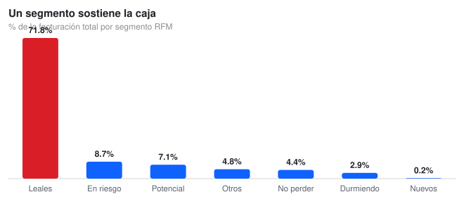
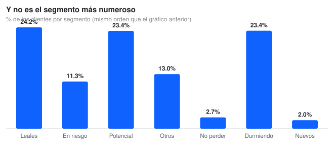
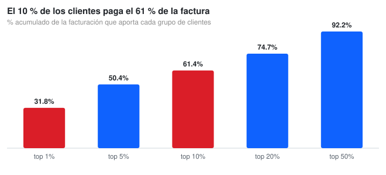

# Online Retail — RFM Segmentation

**4,338 customers, €8.89M of revenue: who pays the bill, and how much of it is walking away**

[](https://www.python.org/)
[](https://pandas.pydata.org/)
[](https://opensource.org/licenses/MIT)

---

## The business question

An online retailer has **4,338 customers** and **8.89 million** in cumulative revenue. Treating them all the same costs money: the customer who buys once a year does not deserve the same effort as the one holding up the P&L. The question is **who pays the bill, who is drifting away, and how much money is at stake**.



---

## What the data says

### 24% of the customers pay 72% of the bill

**1,050 customers classified as *Clientes Leales* generate 71.8% of revenue** (6.38M of 8.89M), with an average spend of **6,077 per customer**. They are not even the largest group: *Durmiendo* and *Potencial Leal* each have more people (1,015 and 1,013) and contribute 2.9% and 7.1%.



Read the two charts side by side — same order, same segments. The tallest bar on the customer chart is not the tallest bar on the revenue chart, and that gap is the whole point.

### The concentration is extreme



The **top 1% of customers pays 31.8% of the bill**, the top 10% pays 61.4%, the top 50% pays 92.2%. Losing a handful of accounts is not losing market share: it is losing a third of the business.

### 13% of revenue is at risk

| Segment | Customers | Revenue | Share of revenue | Avg. spend | Avg. recency (days) |
|:--|--:|--:|--:|--:|--:|
| Clientes Leales | 1,050 | 6,380,981 | 71.8% | 6,077 | 15.9 |
| Clientes en Riesgo | 489 | 768,914 | 8.7% | 1,572 | 119.5 |
| Potencial Leal | 1,013 | 631,888 | 7.1% | 624 | 24.2 |
| Otros | 566 | 427,189 | 4.8% | 755 | 149.6 |
| No se pueden perder | 117 | 395,254 | 4.4% | 3,378 | 89.9 |
| Durmiendo | 1,015 | 261,113 | 2.9% | 257 | 202.6 |
| Nuevos Clientes | 88 | 21,871 | 0.2% | 249 | 9.6 |

*Clientes en Riesgo* and *No se pueden perder* together hold **606 customers (14.0%) and 1.16M — 13.1% of revenue**. Their average recency is 113.8 days against 89.1 for the rest: they have not bought in a while, and they are not one-off buyers.

---

## Reproduce it

```bash
git clone https://github.com/Nicolenki7/Online-Retail-Business-Analysis.git
cd Online-Retail-Business-Analysis

python -m venv .venv && source .venv/bin/activate
pip install -r requirements.txt

python src/rfm_analysis.py   # regenerates outputs/ and the three SVG charts
```

The scored dataset is committed (`rfm_segmentation_final.csv`), so nothing is downloaded and the numbers are reproducible as-is.

---

## Repo layout

```
Online_Retail_Analysis.ipynb        notebook: segments, concentration, at-risk revenue
src/rfm_analysis.py                 the whole analysis from the CLI
src/svg_chart.py                    tiny dependency-free SVG bar chart generator
rfm_segmentation_final.csv          4,338 customers with R/F/M scores and segment
rfm_scores.csv                      raw R/F/M values, no scoring
docs/img/*.svg                      the three charts used in this README
outputs/segment_summary.csv         per-segment aggregates (generated)
```

---

## Method

- **RFM on quartiles.** Each metric is scored 1–4 by quartile, which makes the scores **relative to this customer base**, not absolute thresholds. `RFM_Score` concatenates the three digits (e.g. `444`), and the seven segments are business rules on top of that string.
- **Revenue share.** `Monetary` summed per segment over the total, not averaged, so big accounts weigh what they actually weigh.
- **Pareto.** Customers sorted by spend, cumulative share computed at 1/5/10/20/50% cut-offs.
- **At-risk revenue.** Sum of `Monetary` for the two segments whose recency and frequency say they are leaving.

The full segmentation logic (scoring and rules) was built in the notebook; `src/rfm_analysis.py` reproduces the reporting layer from the committed scores.

---

## Limitations

- **RFM scores are relative.** They are quartiles of this base: adding new customers reshuffles everyone's scores, so two runs separated in time are not comparable without rescoring.
- **`Monetary` has no date.** A customer who spent a lot two years ago and one spending the same this month get the same M score. Recency compensates partially, not fully.
- **The committed CSV has no timeline and no product dimension**: it cannot show seasonality or which categories drive the spend.
- **The segment cut-offs are business rules**, not clusters from a model. They are explainable and actionable, and also debatable — k-means would produce different groups on the same data.
- Revenue may include cancellations and returns from the original dataset; that cannot be audited from the committed file.

## Where this would go next

Move from segment to expected value: combine each customer's repurchase probability with their ticket size to decide who is worth rescuing first. With 13.1% of revenue at risk, the order of the call list is worth more than its length.

---

## 📄 License

MIT for the analysis code. The dataset keeps its original public license (UCI Online Retail).
